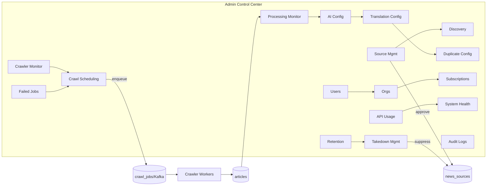

# Admin Control Center Reference

Derived from SKILL.md §19 (Admin Control Center), §02 (Source Registry), §03 (Crawling), §15 (Compliance), §16 (Evidence), §17 (Coverage Analytics). All 17 modules are required; the capabilities listed in §19 are the minimum action surface.

Access: `admin` and `super_admin` roles only (§security-compliance §1.3). Every admin mutation writes to `audit_logs` with actor, target, before/after diff, and request id. Step-up MFA required (§security-compliance §1.2).

## Module Map

| # | Module | Primary tables | Purpose |
|---|--------|---------------|---------|
| 1 | Global Source Management | `news_sources`, `source_domains`, `source_endpoints`, `source_permissions` | CRUD on the source registry; lifecycle status |
| 2 | Source Discovery | `news_sources` (status=`discovered`), discovery job results | Review machine-discovered publishers; approve/reject |
| 3 | Crawler Monitoring | `crawl_jobs`, `crawl_attempts`, `crawl_logs`, `source_health_logs` | Live crawler health, throughput, errors |
| 4 | Crawl Scheduling | `crawl_jobs`, scheduler config | Intervals, priorities, per-domain budgets |
| 5 | Failed Job Management | `crawl_jobs` (failed), dead-letter queue | Triage, retry, discard |
| 6 | Article Processing Monitor | pipeline stage metrics | Watch DISCOVERY→DELIVERY stages, stage latency |
| 7 | AI Processing Config | provider abstraction config | Model selection, prompts, budgets, fallbacks |
| 8 | Translation Config | `article_translations`, language config | MT provider, target languages, labeling rules |
| 9 | Duplicate Detection Config | dedup thresholds | Six-level dedup (§07) tuning |
| 10 | User Management | `users`, `user_preferences` | Accounts, roles, sessions, bans |
| 11 | Organization Management | `organizations`, memberships | Tenant CRUD, seats, ownership transfer |
| 12 | Subscription Management | `subscriptions` | Tiers (§20), entitlements, overrides |
| 13 | API Usage | API key usage analytics | Per-key/per-tier consumption, quotas |
| 14 | System Health | `system_metrics`, infra probes | Queue depth, worker status, DB/OpenSearch/Redis health |
| 15 | Security Audit Logs | `audit_logs` | Searchable, filterable, exportable audit trail |
| 16 | Data Retention | retention policies | Per-class retention, purge jobs, legal holds |
| 17 | Publisher Takedown Management | takedown cases, suppression list | Intake → action → confirm (§security-compliance §2.4) |

## 1. Global Source Management

Registry fields per SKILL.md §02 — every source row carries all required fields: `source_id`, publisher name, domain, country, region, city, primary language, supported languages, editorial category, source type, RSS endpoint, sitemap endpoint, API endpoint, collection method, license information, robots.txt status, ToS status, last successful collection, last article discovered, reliability metadata, operational status, coverage score.

Actions:

- **Add source manually**: domain → run discovery probe (feeds, sitemap, API, metadata) → operator confirms fields → status `pending_review` → approve activates collection.
- **Edit source**: endpoints, category, languages, collection method, priority (HIGH/MEDIUM/LOW per §03).
- **Disable/enable**: sets `operational_status`; disabled sources stop scheduling immediately; in-flight jobs finish or are cancelled.
- **Lifecycle states**: `discovered → pending_review → active → degraded → disabled → discontinued`. `discontinued` is set automatically when availability monitoring (§02.13) confirms prolonged failure or publisher shutdown notice.
- **Bulk ops**: enable/disable by country/category/status filter, with mandatory confirmation and audit entry.
- **Coverage view**: per-source `coverage_score` feeding the §17 World Coverage Matrix.

Hard rule enforcement: a source cannot be activated unless `source_permissions` has recorded robots.txt evaluation and ToS status ≠ `prohibited` (§security-compliance §2.2–2.3).

## 2. Source Discovery

- Discovery jobs scan candidate domains (seed lists, certificate transparency, feed directories, press-release wires) and produce `discovered` candidates with probed endpoints.
- Review queue shows: domain, detected country/language/category, found RSS/Atom feeds, sitemap, public API hints, robots status, duplicate-domain matches (§02.11).
- **Approve** → creates `news_sources` row in `pending_review` (or `active` if auto-approve rules pass). **Reject** → recorded with reason; suppresses rediscovery of the same domain for a configurable period.
- Duplicate handling: canonical domain comparison + redirect resolution; duplicates are flagged, never silently merged.
- Discovery never auto-activates sources that fail permission checks.

## 3. Crawler Monitoring

- Live dashboard: jobs/sec, success/failure rates per source, per-domain latency, queue depth, worker count, circuit-breaker states.
- Per-source drill-down: `source_health_logs` timeline, recent `crawl_attempts`, last article discovered, `last successful collection`.
- Health bands: `healthy | degraded | failing | circuit_open`. `failing` = consecutive failures over threshold; `circuit_open` = breaker tripped (§1.4 resilience).
- Alert hooks: sustained failure rate, latency p95 breach, queue backlog growth → wire to Prometheus/Grafana/Sentry (names in runbook).

## 4. Crawl Scheduling

- Per-source `crawl_interval` with adaptive adjustment: unchanged content (via `ETag`/`If-Modified-Since`/`Last-Modified`, §03) lengthens interval; changed content shortens it; bounds configurable.
- Priority classes HIGH/MEDIUM/LOW control worker allocation; breaking-news sources can be promoted to HIGH dynamically.
- Per-domain rate limit: requests/sec + max concurrency per domain; global per-worker concurrency cap.
- Schedule preview: next N scheduled runs per source; manual "crawl now" button (respects rate limits and permissions).
- Quiet windows: optional per-source off-hours to be a good citizen.

## 5. Failed Job Management

- Lists `crawl_jobs` in `failed`/`dead_letter` state with error class: `timeout`, `5xx`, `robots_disallowed`, `parse_error`, `rate_limited`, `circuit_open`, `permission_revoked`.
- Actions: **retry** (with backoff reset), **retry with override** (e.g., after HTML fix deployed — requires reason, audited), **discard** (moves to dead-letter archive), **suppress source** (opens source mgmt).
- Bulk retry capped per operation; retry storms prevented by per-domain cooldown.
- Dead-letter retention configurable; unresolved dead letters older than N days surface in retention review.

## 6. Article Processing Monitor

- Pipeline stage view (SKILL.md §04): DISCOVERY → COLLECTION → EXTRACTION → VALIDATION → NORMALIZATION → LANGUAGE DETECTION → TRANSLATION → CLASSIFICATION → ENTITY EXTRACTION → DUPLICATE DETECTION → EVENT LINKING → INDEXING → STORAGE → USER DELIVERY.
- Per-stage metrics: throughput, p50/p95 latency, error rate, drop reasons.
- Article inspector: full provenance chain — source → crawl job → extraction result → each pipeline stage output → final record. Every data point must trace (§24).
- Stuck-article detection: items idle in a stage beyond threshold; manual requeue per stage.

## 7. AI Processing Config

- Provider abstraction (SKILL.md §13: never single-provider): configure primary + fallback LLM/embedding providers, model names, temperature, token budgets per task type.
- Task-level toggles: summarization, classification, entity extraction, event detection, Q&A grounding, briefings.
- Guardrails: max input length, citation-required flag for briefings (§16), confidence thresholds for entity/event linking.
- Cost controls: per-day token budget, per-source AI opt-out honored (§security-compliance §2.7).
- Prompt/version registry: every prompt change is versioned; rollbacks supported.

## 8. Translation Config

- MT provider config (primary + fallback), supported target languages (initial 18 per §05 plus extensible).
- Rules: never replace original (§05 sacred rule); store `article_translations` rows with `kind=machine_translation`, source text hash, model version, timestamp.
- Per-language enable/disable; per-source translation opt-out honored.
- Quality sampling: flag translations below confidence threshold for review; never display unlabeled MT.

## 9. Duplicate Detection Config

Six levels per SKILL.md §07. Configurable per level:

| Level | Knobs |
|-------|-------|
| 1 URL exact | — (always on) |
| 2 Canonical URL | canonicalization rules, redirect chains |
| 3 Normalized headline | normalization rules (case, punctuation, whitespace, stopwords), similarity threshold |
| 4 Content fingerprint | shingle size, MinHash bands, Jaccard threshold |
| 5 Semantic similarity | embedding model, cosine threshold, near-dup band |
| 6 Event identification | clustering algorithm params, temporal window, entity overlap weights |

- Critical invariant displayed in UI: **same event ≠ same article**. Level 6 creates `event_articles` relationships; it must never merge or delete publisher-level `articles` rows. Original publication timestamps always preserved.
- Dry-run mode: test new thresholds against last N days of articles and show would-be merge/link counts before applying.

## 10. User Management

- User CRUD: search by email/id, view profile, roles, org memberships, subscription, last login, session list (revoke sessions).
- Actions: change role (audited, requires reason), suspend/ban (immediate session revocation), force password reset, anonymize (GDPR erasure, §security-compliance §2.9).
- Impersonation: not supported — support uses read-only diagnostics instead.
- Bulk import for enterprise orgs.

## 11. Organization Management

- Org CRUD: name, seats, owner, billing contact, tenant settings.
- Membership: invite, role assignment (`org_member`, `org_admin`), removal; ownership transfer with dual confirmation.
- Tenant isolation health check: report any cross-tenant query anomalies.
- Org-level policies: allowed content classes, retention overrides within legal bounds, SSO config hooks (enterprise).

## 12. Subscription Management

- Tiers per §20: FREE / PRO / BUSINESS / ENTERPRISE with entitlements matrix (daily article cap, search depth, AI summaries, alerts, exports, API access, seats, retention, licensed content flag).
- Manual overrides: grant/revoke tier, comp accounts, trial extension — all audited.
- Entitlement enforcement points listed (article caps, saved-search limits, API quota class, export permission).
- Billing integration status shown; manual invoicing path for enterprise.

## 13. API Usage

- Per-key analytics: requests/day, endpoints, status codes, latency p95, last used, scope usage.
- Per-tier aggregate: consumption vs quota, top consumers, abuse signals (429 storms, scanning patterns).
- Key management shortcuts: rotate, revoke, extend expiry; link to user/org.
- Export usage reports (CSV/JSON) for enterprise billing reconciliation.

## 14. System Health

- Service map: Postgres, OpenSearch, Redis, Kafka/Redpanda, S3, crawler workers, AI workers, API servers — status, latency, error rate.
- Queue health: depth, consumer lag, oldest message age per topic/queue; DLQ size.
- Resource metrics: CPU/mem/disk per node (or pod), DB connection pool usage, OpenSearch cluster health (yellow/red alerts).
- Degradation banner control: admin can set read-only mode or disable optional features (semantic search, briefings) during incidents.
- All panels backed by `system_metrics` + Prometheus; no decorative gauges (§24).

## 15. Security Audit Logs

- Searchable `audit_logs`: filter by actor, action, target type/id, date range, result.
- Detail view: full diff, IP, user agent, request id → trace link.
- Integrity: append-only; export for compliance review; retention ≥ 12 months regardless of content retention settings.
- Anomaly flags: impossible-travel logins, mass role changes, retention policy edits, takedown actions — surfaced as review items.

## 16. Data Retention

- Policy editor per data class: article metadata, full text, translations, embeddings, search history, notifications, audit logs, crawl logs, backups.
- Shows row counts and storage footprint per class before applying; purge runs as background jobs with progress and audit entry.
- Legal hold flag per class/org: suspends purge for litigation/investigation.
- Verification report: post-purge counts proving deletion cascaded (articles → versions, embeddings, event links consistent).

## 17. Publisher Takedown Management

- Case queue: intake (web form/email/manual), status (`received → verifying → actioned → confirmed → rejected`), SLA timer (target ≤ 72 h, §security-compliance §2.4).
- Actions per case: remove article(s), downgrade to metadata-only, restrict display, reject with reason; each writes tombstone + suppression-list entry.
- Suppression list: URLs/domains that must not be re-ingested without review; enforced in the ingestion pipeline before storage.
- Publisher policy editor: per-source `content_storage` ceiling, attribution string, image policy, `ai_processing` opt-out — changes propagate to existing articles via downgrade/purge jobs.
- Metrics: open cases, SLA breaches, removals by reason, repeat requesters.

## Cross-cutting capabilities (§19)

| Capability | Where it lives |
|------------|---------------|
| Add sources manually | Module 1 + 2 |
| Approve discovered sources | Module 2 |
| Disable sources | Module 1 |
| Configure intervals | Module 4 |
| Per-domain rate limits | Module 4 |
| Review extraction failures | Module 6 |
| Retry failed jobs | Module 5 |
| Queue health | Module 14 |
| Article provenance | Module 6 (article inspector) |
| Publisher policies | Module 17 |

## Admin API & UI requirements

- All admin actions available via UI; destructive/bulk actions require typed confirmation.
- Admin endpoints under `/api/v1/admin/*` require `admin:read`/`admin:write` scopes and step-up MFA; rate-limited separately.
- Every admin page shows last-updated timestamps from real queries; empty states explain why (§24 — no fabricated stats).
- Admin changes to AI/translation/dedup config take effect via versioned config rollout with a "pending → active" state and rollback button.
