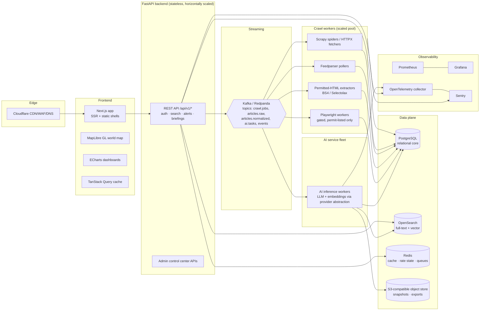
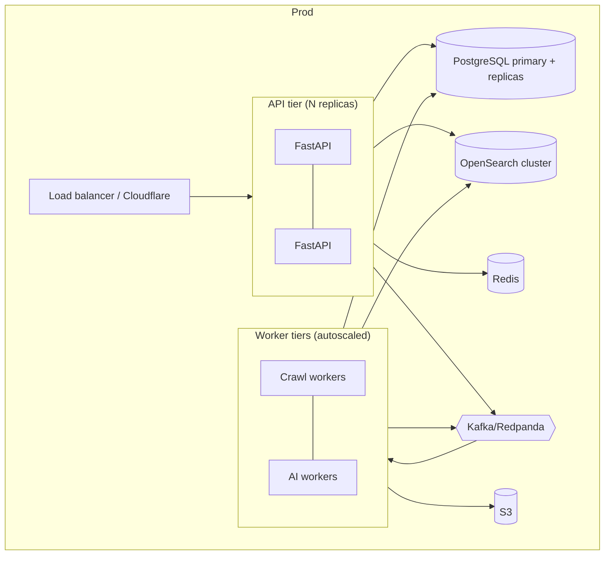

# Architecture — NEWS OMNIVERSE

Global news intelligence platform: discovery → collection → extraction →
validation → normalization → language detection → translation → classification →
entity extraction → duplicate detection → event linking → indexing → storage →
user delivery (SKILL §04).

## 1. Technology map (from SKILL §13)

| Layer | Stack |
|-------|-------|
| Frontend | Next.js · TypeScript · Tailwind CSS · shadcn/ui · Framer Motion · TanStack Query · MapLibre GL · ECharts |
| Backend | Python · FastAPI · Pydantic · SQLAlchemy |
| Data | PostgreSQL · OpenSearch · Redis · Kafka or Redpanda · S3-compatible object storage |
| Crawling | Scrapy · HTTPX · Feedparser · BeautifulSoup · Selectolax · Playwright (gated) |
| AI | LLM provider abstraction · embedding model abstraction · multilingual NLP · entity recognition · semantic search · classification pipeline — **never a single AI provider** |
| Infra | Docker · Kubernetes (only when justified) · Cloudflare · GitHub Actions · Prometheus · Grafana · OpenTelemetry · Sentry |

## 2. Component diagram

## 3. Service boundaries

### 3.1 Edge / CDN (Cloudflare)
Static asset caching, TLS termination, WAF, DDoS absorption. The frontend is
deployed as a Next.js app; heavy dashboard data always comes from the API —
never fabricate client-side metrics (§24 anti-slop: every data point traceable).

### 3.2 Frontend (Next.js + TypeScript)
- **Pages:** Global Overview, World News Map (MapLibre GL), Live News Feed,
  Breaking News Center, Trending Topics, Global Timeline, Source Intelligence,
  AI Briefing (SKILL §08 modules).
- **State/data:** TanStack Query for server state; no fake real-time — live
  indicators must be backed by real polling/WebSocket data.
- **Charts:** ECharts for topic trends, coverage matrices, ingestion latency.
- **Search UI:** keyword/semantic modes, operators (`AND OR NOT`, phrases,
  date ranges, domain, country, language), autocomplete, saved searches,
  search alerts (SKILL §09).
- **Theming:** dark intelligence interface — deep midnight background,
  graphite surfaces, electric blue accents, controlled amber highlights,
  high-contrast typography, premium information density (§08). No neon spam,
  no generic AI-dashboard aesthetics.

### 3.3 Backend API (FastAPI + Pydantic + SQLAlchemy)
Stateless. Owns:
- `/api/v1/*` surface per §18 (news, search, events, topics, trending,
  sources, countries, languages, coverage, briefings, alerts,
  saved-searches, collections).
- AuthN/AuthZ: secure authentication, RBAC, MFA, API keys for the public API
  (§15).
- Admin Control Center APIs (§19): source management, crawler monitoring,
  AI config, takedown management, system health.
- Rate limiting, input validation, output sanitization.

### 3.4 Data plane
| Store | Role |
|-------|------|
| PostgreSQL | Relational core: all ~35 tables (§14). Source of truth for users, sources, articles, events, permissions, audit. |
| OpenSearch | Full-text search, filters, semantic/vector search over embeddings, autocomplete, relevance ranking (§09). |
| Redis | Hot cache (trending topics, dashboards), rate-limit counters, crawl scheduling state, short-lived dedupe keys. |
| Kafka/Redpanda | Event backbone between collectors, normalizers, and AI workers. Topic names are a design detail; durability + replay required. |
| S3-compatible | Article snapshots where licensed, briefing exports, large payloads offloaded from PG rows. |

### 3.5 Crawl worker fleet
See `references/crawling.md`. Workers are **isolated**: a failing publisher
must never interrupt collection infrastructure (§03 invariant). Horizontal
scaling is per-worker-type; each worker carries its own per-domain rate state.

### 3.6 AI service fleet
Provider-agnostic inference workers consuming normalized articles from the
queue. Capabilities defined in `references/intelligence.md`. Every AI output is
attributed (§24) and must degrade gracefully when a provider is unavailable
(§21 graceful degradation).

## 4. Request/data flow

1. **Collection:** scheduler → permission check → fetch → extract → normalize
   → dedupe → persist raw + normalized article (§03/§04 pipeline).
2. **Enrichment:** normalization output → language detection → translation →
   classification → entity extraction → event linking → embedding → index.
3. **Serving:** API reads PG (relational), OpenSearch (search/vector), Redis
   (hot aggregates). Dashboard metrics are computed from real ingestion
   counters — `system_metrics` + coverage tables (§17).

## 5. Scaling model

Targets (§21, engineering targets — not coverage claims):

| Dimension | Target |
|-----------|--------|
| Registered sources | 10,000+ |
| Article metadata records | 1,000,000+ |
| Concurrent users | 1,000 |
| Ingestion | continuous, background AI processing |
| Latency | search p95 < 500ms; dashboard API p95 < 500ms |

- **Horizontal worker scaling** for crawlers and AI workers; the queue
  (Kafka/Redpanda) decouples producers/consumers so workers scale
  independently.
- **PostgreSQL:** partition large tables (articles by publication month,
  crawl logs by day); read replicas for API read paths.
- **OpenSearch:** index sharding by time; aliases for zero-downtime reindex.
- **Caching:** Redis for trending topics, coverage matrix aggregates,
  per-user preference payloads. Cache trending explicitly (§21).
- **Load tests must be established before raising targets** (§21).

## 6. Graceful-degradation rules

Ordered fallbacks — the platform keeps serving when components fail:

1. **Search infra (OpenSearch) down** → keyword search falls back to
   PostgreSQL full-text (`tsvector`); semantic/vector search disabled with an
   explicit UI state. Never show empty results silently.
2. **AI provider down** → serve un-enriched articles (headline, publisher,
   link); queue enrichment for retry; disable summary/translation features
   for new articles until provider recovers. Existing summaries remain.
3. **Kafka/Redpanda down** → ingestion falls back to direct synchronous
   processing at reduced rate; alert on queue depth.
4. **Redis down** → bypass cache; rate limiting enforced at API gateway only;
   trending computed on-demand from PG.
5. **S3 down** → object-dependent features (exports, snapshots) fail loudly;
   core article metadata unaffected.
6. **One publisher/source fails** → isolate via per-source circuit breaker;
   continue all other sources (§03 invariant).
7. **Embedding model unavailable** → semantic search degraded to
   keyword/metadata search; embeddings retried later.

Every degraded mode surfaces honestly in the UI and in
`source_health_logs` / `system_metrics` — no fake data (§24).

## 7. Infrastructure policy

- **Docker** for all services; compose for local dev.
- **Kubernetes only when justified** — adopt when worker scaling, multi-region,
  or HA requirements exceed what a VM + compose can deliver. Do not introduce
  K8s complexity without measurable operational justification (§13).
- **CI:** GitHub Actions — lint, type-check, unit/integration tests, build,
  deploy gates.
- **Observability:** Prometheus metrics, Grafana dashboards, OpenTelemetry
  traces across API → queue → workers → AI, Sentry error tracking.
- **Secrets:** managed secrets store; never in repo. `.env.example` documents
  every required variable (§22 deliverables).

## 8. Deployment topology (reference)

## 9. Cross-cutting rules

- **No single AI provider** (§13): all LLM and embedding calls go through the
  provider abstraction; models are configuration, not code.
- **Publisher policies** (§15): per-source content policy decides whether
  full text is stored; default is metadata + headlines + links.
- **Auditability:** every ingestion and admin mutation writes to
  `audit_logs`; every article preserves original publisher + URL (§04).
- **Takedown handling:** takedown requests are an admin workflow that must be
  able to suppress article display while preserving audit trail (§19, §15).
